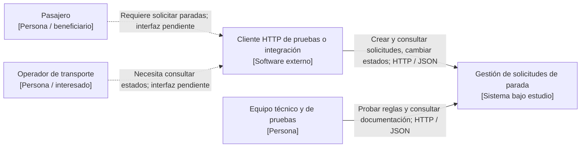

# Práctica 02 — Vista C4 nivel 1: contexto

**Caso:** Paradas Inteligentes — módulo de gestión de solicitudes de parada.  
**Audiencia:** responsables del servicio, usuarios interesados y equipo académico.  
**Límite:** se documenta una API REST de solicitudes de parada; **no** el sistema integral de transporte, ETA, GPS ni notificaciones.

## Elementos y responsabilidades

| Elemento | Categoría C4 | Responsabilidad / estado |
|---|---|---|
| Pasajero | Persona interesada | Requiere registrar una solicitud sin pérdida ni duplicación. Actualmente **no dispone de interfaz de usuario desarrollada** en este prototipo. |
| Operador de transporte | Persona interesada | Necesita información consistente de estados. La interfaz operativa está **fuera del prototipo**. |
| Cliente consumidor REST | Software externo conceptual / cliente de prueba | Envia solicitudes HTTP y consulta la API. Se puede usar un cliente de pruebas; no se afirma que exista una app móvil. |
| Equipo técnico y de pruebas | Persona / equipo | Ejecuta solicitudes de prueba, revisa los contratos HTTP y reglas. |
| Gestión de solicitudes de parada | Sistema bajo estudio | Expone `GET /paradas`, `POST /solicitudes`, `GET /solicitudes/{id}` y `PATCH /solicitudes/{id}/estado`. |

## Diagrama de contexto como código (Mermaid)

**Lectura del contexto:** las líneas discontinuas representan necesidades o integraciones **previstas**, no conexiones implementadas. Las líneas continuas indican el contrato expuesto por el prototipo. En este nivel se representa el sistema como una sola unidad: no se muestra una base de datos.

**Trazabilidad:** pasajero → S1 y D1/D2; operador → S2 y D1; cliente → S5 y D4; equipo técnico → S3 y D5. Ver [drivers y escenarios](../01-contexto-y-drivers.md) y [C4 nivel 2](c4-nivel2.md).
