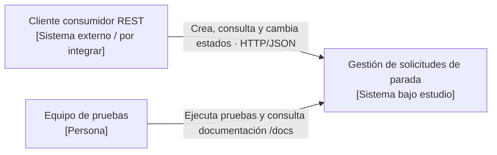

# Práctica 02 — Modelo C4, nivel 1 (contexto)

**Objeto:** módulo de gestión de solicitudes de parada de Paradas Inteligentes.  
**Público:** stakeholders no técnicos y equipo de implementación.  
**Alcance:** la API existente; no muestra ETA, GPS, buses, paneles, pagos ni notificaciones porque **no son parte de este prototipo**.

## Elementos

| Elemento | Tipo | Responsabilidad |
|---|---|---|
| Cliente consumidor REST | Sistema/cliente externo de prueba o integración | Envía, consulta y actualiza solicitudes a través de HTTP. La aplicación móvil no está implementada. |
| Equipo QA / desarrollador | Persona | Prueba reglas de negocio con Swagger, Postman y Pytest. |
| Sistema de solicitudes de parada | Software bajo estudio | Gestiona cuatro operaciones REST, catálogo, validación horaria y estados. |

## Vista C4 — Contexto como código

**Interpretación:** el sistema se representa en una sola caja. No se muestran bases de datos ni frameworks (se detallan en nivel 2). En la API actualmente no existe una interfaz móvil implementada; «cliente consumidor REST» representa un rol de integración, no un producto desplegado.

**Validaciones de trazabilidad:** S1/S5 ↔ consumidor; S3 ↔ equipo de pruebas; D1/D2/D3/D4/D5 ↔ sistema. Las decisiones ADR-001 a ADR-003 solo cambian los detalles internos, sin modificar este contexto.
