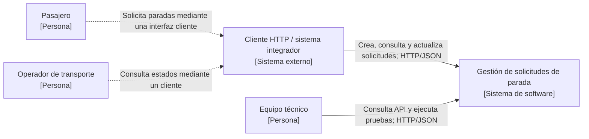

# C4 — Nivel 1: contexto del sistema

La vista define el límite de **Gestión de solicitudes de parada** y sus relaciones con interesados y consumidores externos. No representa componentes internos ni presupone una aplicación móvil desarrollada.

## Relaciones y límites

| Elemento | Responsabilidad | Relación |
|---|---|---|
| Pasajero | Origina la necesidad de solicitar una parada | Usuario interesado, sin interfaz final incluida en el prototipo |
| Operador | Requiere conocer estados correctos | Usuario interesado, sin consola operativa incluida |
| Cliente HTTP o sistema integrador | Consume las operaciones REST | Sistema externo al límite de la API |
| Equipo técnico | Verifica reglas, errores y contrato | Consumidor técnico directo |
| Gestión de solicitudes de parada | Gestiona paradas, solicitudes y estados | Sistema bajo diseño |

Las flechas discontinuas muestran interacciones conceptuales con clientes futuros; las continuas indican el contrato HTTP disponible. GPS, ETA y mensajería permanecen fuera del alcance. La vista de contenedores está en [C4 nivel 2](c4-nivel2.md).
