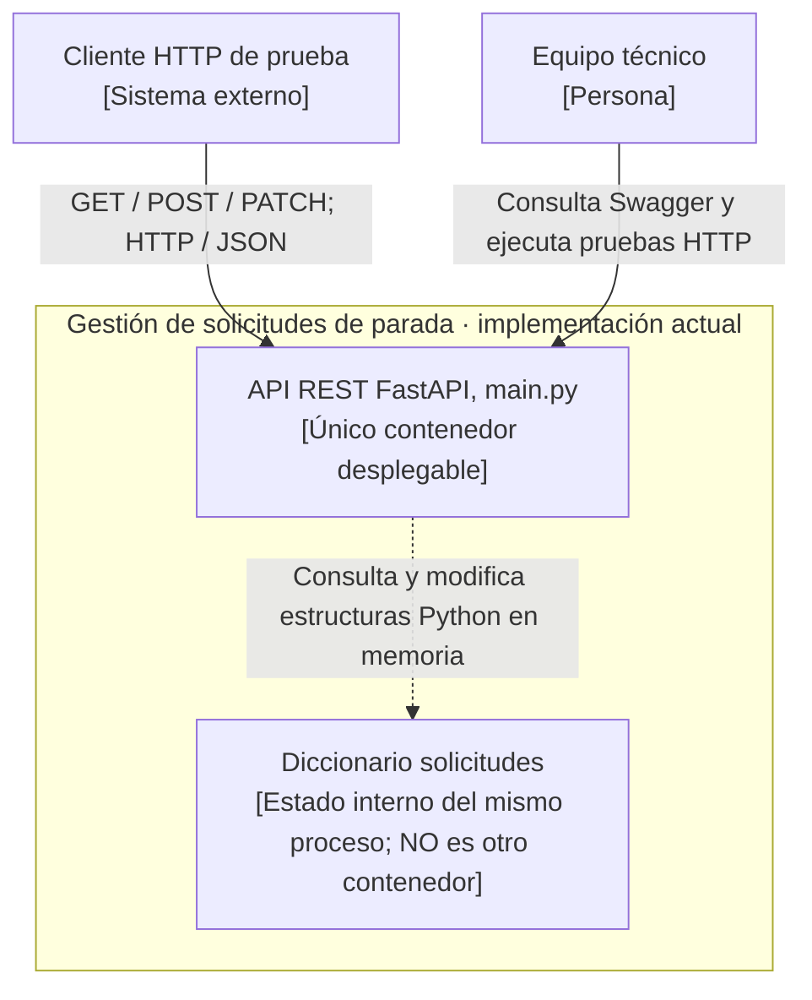

# Vista complementaria — C4 nivel 2 del prototipo actual

**No sustituye la vista objetivo de la Práctica 02.** Se añade solo para diferenciar hechos observados de decisiones futuras.

**Evidencia consultada:** `solicitudes: Dict[int, SolicitudOut] = {}` y funciones de los cuatro endpoints de `main.py`, documentadas en [evidencia técnica](../05-evidencia-tecnica.md). La API actual no persiste registros al reiniciar, no autentica usuarios y no proporciona garantía transaccional entre peticiones concurrentes.
