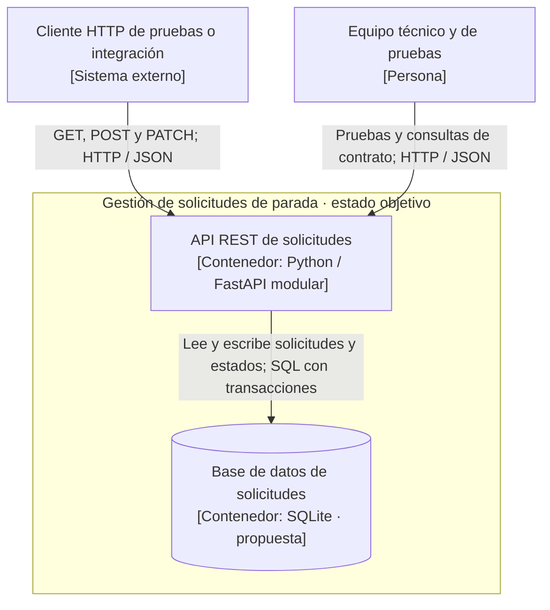

# Práctica 02 — Vista C4 nivel 2: contenedores (arquitectura objetivo)

**Sistema:** Gestión de solicitudes de parada.  
**Estado de la vista:** **objetivo propuesto**, coherente con ADR-001, ADR-002 y ADR-003. Los controles de SQLite, unicidad transaccional y autorización **no están implementados** en el prototipo original.

## Contenedores del sistema y responsabilidades

| Elemento | Tipo | Responsabilidad | Estado |
|---|---|---|---|
| API REST de solicitudes | Contenedor: aplicación Python / FastAPI | Exponer las cuatro operaciones, aplicar validaciones, orquestar solicitudes | FastAPI existe; modularización y control de acceso pendientes |
| Base de datos de solicitudes | Contenedor: almacén relacional SQLite | Persistir solicitudes y estados y preservar unicidad activa mediante transacciones | **Propuesta, sin implementación** |
| Cliente HTTP de pruebas o integración | Sistema externo, fuera del límite | Usar los endpoints; **no es** un contenedor dentro del sistema | Posibilidad de consumo probada con herramientas HTTP |
| Equipo técnico y de pruebas | Persona externa, fuera del límite | Revisar respuestas y ejecutar pruebas de calidad | Actividad académica |

## Diagrama de contenedores como código (Mermaid)

**Correspondencia entre niveles:** el sistema central del nivel 1 se descompone aquí en **dos contenedores internos**. Ni el usuario ni el cliente externo se convierten en contenedores desplegables de nuestro sistema. La API actual consta de un solo `main.py`; la base de datos es una **decisión futura**, no una BD ya existente.

**Vínculos a decisiones:** [ADR-001 persistencia](../03-adr/ADR-001-persistencia-solicitudes.md), [ADR-002 unicidad](../03-adr/ADR-002-unicidad-concurrencia.md), [ADR-003 estilo](../03-adr/ADR-003-estilo-monolito-modular.md), [matriz ponderada](../03-adr/matriz-decision.md).

**Verificación y trade-offs:** E1 comprueba unicidad bajo concurrencia; E2, recuperación tras reinicio; E4, futura autorización. El despliegue único simplifica operación, pero no escala cada módulo por separado. El índice de unicidad protege integridad, pero requiere tratar errores de bloqueo y concurrencia. Para contrastar el **prototipo real**, consultar [C4 nivel 2 actual](c4-nivel2-actual.md).
