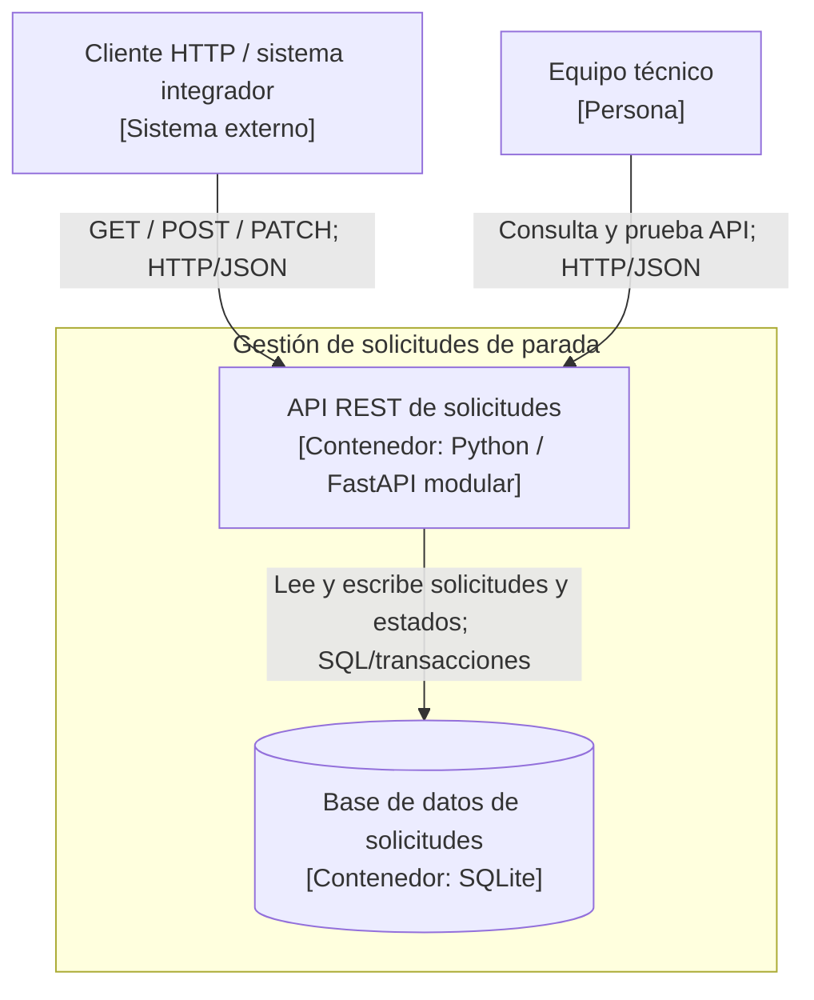

# C4 — Nivel 2: contenedores de la arquitectura seleccionada

La vista representa la **arquitectura objetivo** del módulo de solicitudes: una API FastAPI modular y un repositorio SQLite. La implementación analizada dispone actualmente de una aplicación FastAPI única con datos en memoria; la persistencia y la modularización son decisiones de diseño documentadas en los ADR.

## Catálogo de contenedores

| Contenedor | Tecnología | Responsabilidad | Decisión |
|---|---|---|---|
| API REST | Python / FastAPI | Operaciones REST, validación de horario y estados; separar rutas, reglas y repositorio de datos | ADR-003 |
| Base de datos de solicitudes | SQLite | Persistencia de solicitudes, transacciones y unicidad de solicitudes activas | ADR-001 y ADR-002 |

El consumidor HTTP y el equipo técnico aparecen fuera del límite del sistema. **SQLite corresponde al diseño seleccionado y no a una función ya implementada**. La separación del contenedor FastAPI respecto de SQLite hace visible el compromiso entre operación simple y capacidad de escalar a múltiples instancias.

## Correspondencia con los escenarios

- **E1:** la unicidad se garantiza mediante reglas de base de datos, no solo con una búsqueda previa en memoria.
- **E2:** la persistencia permite recuperar registros tras reiniciar la API.
- **E3:** la validación de estados permanece en la lógica de dominio.
- **E4:** el control de acceso se incorporaría en la API; no forma parte del prototipo analizado.
- **E5:** consultas SQL e índices requieren pruebas bajo la carga definida.
- **E6:** una interfaz de repositorio separa la persistencia de los contratos HTTP.

Consultar [ADR-001](../03-adr/ADR-001-persistencia-solicitudes.md), [ADR-002](../03-adr/ADR-002-unicidad-concurrencia.md), [ADR-003](../03-adr/ADR-003-estilo-monolito-modular.md) y [matriz ponderada](../03-adr/matriz-decision.md).
