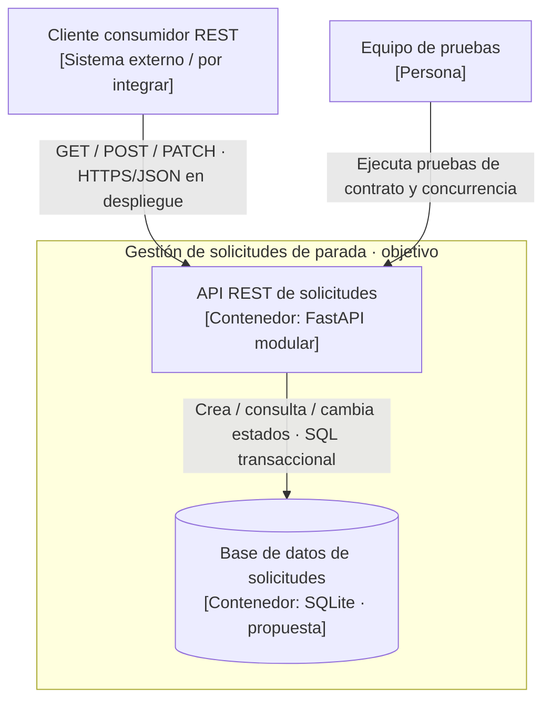

# Práctica 02 — Modelo C4 nivel 2 (contenedores) — propuesta del equipo

**Estado:** diseño objetivo propuesto por ADR-001, ADR-002 y ADR-003; **aún no implementado** en el código original. Mantiene el mismo nombre del sistema, actores y relaciones del nivel 1.

## Contenedores y límites

| Contenedor | Tecnología propuesta | Responsabilidad | Estado |
|---|---|---|---|
| API REST de solicitudes | Python / FastAPI (modularizada) | Validar, servir endpoints, orquestar casos de uso, aplicar seguridad definida | FastAPI existente, separación por módulos y autorización pendientes |
| Base de datos de solicitudes | SQLite con transacciones e índice único parcial | Mantener solicitudes, estados y unicidad activa por pasajero-parada | **Por implementar** |
| Cliente REST | Swagger UI, Postman o cliente de integración | Consumir API, no es una aplicación móvil construida | Consumo de prueba existente |

## Vista C4 — Contenedores como código

**Relación con ADR:** ADR-001 define almacenamiento; ADR-002 exige garantizar unicidad de solicitudes activas usando un índice único parcial más transacciones; ADR-003 justifica mantener un único despliegue con organización modular, sin crear microservicios para este piloto académico.

**Compromisos (trade-offs):** un único proceso y SQLite simplifican la operación, pero limitan escalamiento horizontal y alta disponibilidad; introducir control de acceso requiere diseño y pruebas adicionales; cambio futuro a PostgreSQL debe revisarse en el ADR correspondiente si existen varias instancias.

**Advertencia de consistencia:** esta vista expresa el **estado esperado**, no el código incluido en el repositorio. Para comparar consultar [`c4-nivel2-actual.md`](c4-nivel2-actual.md). No se ha declarado cumplimiento de E1, E2 ni E4.
