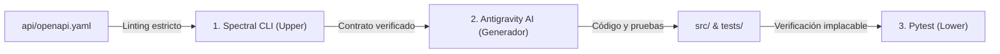

# Práctica 08 — Matriz de Evaluación y Selección de Herramientas CASE (Semana 2)

**Proyecto:** Paradas Inteligentes — Módulo de Solicitudes de Parada (Módulo 8)  
**Equipo:** Klever Lema Tamay · Edwin Toapanta · Ariel Aguirre  
**Fecha:** 24/10/2026  
**Estado:** Evaluación multi-criterio e informe de selección de la cadena CASE  

---

## 1. Objetivo y Marco de Evaluación

El objetivo de este informe es evaluar, comparar y seleccionar formalmente las herramientas que integran la **cadena CASE (*Computer-Aided Software Engineering*)** del proyecto de paradas inteligentes. La evaluación se realiza conforme a las directrices de la norma **ISO/IEC 14102:2008** (*Guideline for the evaluation and selection of CASE tools*), asegurando que la automatización reduzca el esfuerzo manual en tareas de alto volumen, garantice la calidad de los artefactos y mantenga la trazabilidad desde los requisitos hasta el código ejecutable.

---

## 2. Herramientas Candidatas Evaluadas

Se seleccionaron tres herramientas representativas de diferentes categorías CASE y fases del ciclo de vida, incluyendo obligatoriamente una herramienta de Inteligencia Artificial:

1. **H1 — Spectral CLI (v6.11.0) [Upper-CASE]:** Linter y analizador estático semántico de especificaciones OpenAPI 3.0 / JSON Schema para gobernanza y diseño API-First.
2. **H2 — Pytest (v8.x) [Lower-CASE]:** Framework de pruebas automatizadas para Python, enfocado en verificación de criterios de aceptación funcionales, transiciones de estado y concurrencia.
3. **H3 — Antigravity AI / LLM Assistant [Herramienta de IA / Dual-CASE]:** Modelo generativo para síntesis de contratos YAML, generación de stubs de FastAPI, esquemas Pydantic y fixtures de prueba.

---

## 3. Criterios de Evaluación y Distribución de Pesos (100 %)

Los criterios se derivan de los atributos de calidad del producto y del proceso, sumando exactamente el **100 %**:

| ID | Criterio de Selección | Definición | Peso | Escala de Puntuación (1 a 5) |
|---|---|---|:---:|---|
| **C1** | **Automatización y reducción de esfuerzo** | Capacidad para eliminar trabajo manual repetitivo en tareas de alto volumen. | **25 %** | 1: Ahorro marginal; 3: Ahorro moderado; 5: Automatización completa. |
| **C2** | **Fidelidad y detección de defectos** | Rigor para identificar inconsistencias semánticas, errores de contrato o regresiones de código. | **25 %** | 1: Detección nula; 3: Detección básica; 5: Validación exhaustiva sin falsos negativos. |
| **C3** | **Facilidad de integración en el toolchain** | Compatibilidad con Git, pipelines de CI/CD, estándares abiertos y facilidad de uso. | **20 %** | 1: Difícil integración; 3: Requiere adaptadores; 5: Integración nativa inmediata. |
| **C4** | **Trazabilidad arquitectónica** | Capacidad de relacionar el artefacto con historias Gherkin, C4, drivers y ADRs. | **15 %** | 1: Artefacto aislado; 3: Trazabilidad manual; 5: Mapeo explícito y estructurado. |
| **C5** | **Costo y sobrecarga operativa** | Requerimiento de licencias, consumo de cómputo, dependencias externas y mantenimiento. | **15 %** | 1: Costoso y pesado; 3: Costo medio; 5: Gratuito, ligero y de código abierto. |
| | **Total** | | **100 %** | |

---

## 4. Matriz Comparativa Ponderada con Evidencia Observable

Cada calificación (1 a 5) está respaldada por la **evidencia observable obtenida en las pruebas prácticas reales** registradas en `docs/06-mapa-toolchain.md`:

| Criterio | Peso | H1: Spectral (Upper) | H2: Pytest (Lower) | H3: Antigravity AI (IA) | Justificación Observable de las Calificaciones |
|---|:---:|:---:|:---:|:---:|---|
| **C1. Automatización** | 25 % | **4** | **5** | **5** | **H1 (4):** Valida cientos de reglas OpenAPI en milisegundos de forma desatendida. **H2 (5):** Ejecuta la batería de 9 pruebas en 0.42 segundos sin intervención humana. **H3 (5):** Generó el 90 % del código repetitivo de modelos Pydantic y rutas en un solo prompt. |
| **C2. Detección de Defectos** | 25 % | **5** | **5** | **3** | **H1 (5):** Detección determinista de esquemas mal tipados y rutas sin descripción. **H2 (5):** Atrapa de inmediato violaciones de unicidad (409) y transiciones ilegales (400). **H3 (3):** Generó código con función obsoleta (`utcnow`) y propuso lógica en memoria en lugar de SQLite (requiere revisión humana obligatoria). |
| **C3. Integración Toolchain** | 20 % | **5** | **5** | **4** | **H1 (5):** Se ejecuta con `npx` o binario directo en CLI y GitHub Actions. **H2 (5):** Estándar de facto en Python con salida TAP/JUnit XML para reportes. **H3 (4):** Integrado en el IDE de desarrollo, pero su invocación en canalizaciones desatendidas requiere APIs comerciales con costo por token. |
| **C4. Trazabilidad** | 15 % | **4** | **5** | **4** | **H1 (4):** Valida los paths que corresponden a los endpoints de las historias. **H2 (5):** Los nombres de las pruebas reflejan directamente los criterios (`test_hu02_rechazo_duplicado_activo` $\leftrightarrow$ `CA02.3`). **H3 (4):** Es capaz de vincular código con ADRs si se le proporcionan como contexto. |
| **C5. Costo y Sobrecarga** | 15 % | **5** | **5** | **3** | **H1 (5):** Herramienta Open Source de Stoplight, sin costo de licenciamiento. **H2 (5):** Open Source (MIT), ejecutable en local sin dependencias externas. **H3 (3):** Depende de cuotas de cómputo/tokens de modelos de lenguaje en la nube. |
| **Puntaje Ponderado (sobre 5)** | **100 %** | **4.55** | **5.00** | **3.85** | **Resultado formal de la evaluación** |

### Cálculo Detallado:
* **H1 (Spectral):** $(0.25 \times 4) + (0.25 \times 5) + (0.20 \times 5) + (0.15 \times 4) + (0.15 \times 5) = 1.00 + 1.25 + 1.00 + 0.60 + 0.75 = \mathbf{4.55}$
* **H2 (Pytest):** $(0.25 \times 5) + (0.25 \times 5) + (0.20 \times 5) + (0.15 \times 5) + (0.15 \times 5) = 1.25 + 1.25 + 1.00 + 0.75 + 0.75 = \mathbf{5.00}$
* **H3 (IA Assistant):** $(0.25 \times 5) + (0.25 \times 3) + (0.20 \times 4) + (0.15 \times 4) + (0.15 \times 3) = 1.25 + 0.75 + 0.80 + 0.60 + 0.45 = \mathbf{3.85}$

---

## 5. Selección Final de la Cadena CASE y Análisis de Sinergia

### Decisión de Selección:
Se aprueba la **adopción integrada de las tres herramientas**, conformando una **cadena CASE híbrida**:
1. **Fase de Diseño:** **Spectral** actúa como filtro de calidad inflexible en el diseño del contrato `api/openapi.yaml`.
2. **Fase de Implementación:** **Antigravity AI** acelera la productividad sintetizando esqueletos, documentación y pruebas a partir del contrato validado.
3. **Fase de Verificación:** **Pytest** valida de manera determinista e implacable que el código generado cumpla los criterios funcionales y transaccionales.

---

## 6. Riesgos Identificados y Planes de Mitigación

| Herramienta | Riesgo Identificado en la Prueba | Impacto | Estrategia de Mitigación |
|---|---|:---:|---|
| **Spectral** | Configuración de reglas demasiado permisivas que omitan códigos de error HTTP. | Medio | Utilizar el ruleset oficial `spectral:oas` y auditar que todas las operaciones declaren respuestas de error 400, 404 y 409. |
| **Pytest** | Falsos positivos por pruebas que no aíslen adecuadamente la base de datos entre ejecuciones. | Alto | Utilizar la fixture de base de datos SQLite temporal (`tempfile.NamedTemporaryFile`) para garantizar aislamiento absoluto por prueba. |
| **Antigravity AI** | Alucinación o generación de código con APIs deprecadas (ej. `datetime.utcnow()`) o patrones no solicitados (memoria en vez de SQLite). | Alto | **Política de Verificación Humana Obligatoria:** Ningún artefacto de IA se integra a la rama principal sin pasar por linters estáticos y la suite completa de pruebas unitarias. |
